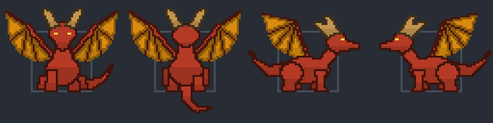

# Dragon sprite spec (four-legged tribes)

SkyWing is the test tribe. Its placeholder art was generated by `Tools/_WoF/gen_skywing.py`. Replace the
PNGs with real art and keep the same file and state names, and nothing in the code needs to change.

Draw original art from the books' written descriptions of each tribe. Don't trace or copy the covers, the
graphic novels or official illustrations, because that art can't be licensed into this repo.

## Canvas and directions

- **Frame size:** 64×64 per frame, about two tiles wide. The frame is centered on the dragon's tile, so the tile it stands on is the middle 32×32 (x 16–47, y 16–47). Put the feet around y 46–47.
- **Directions:** every state has 4 directions. The PNG is a 128×128 sheet in a 2×2 grid:

  | | left column | right column |
  |---|---|---|
  | **top row** | south (facing the viewer) | north (facing away) |
  | **bottom row** | east (facing right) | west (facing left) |

- **Grayscale:** draw the body parts in grayscale with light values, around 230 for lit areas and 200 for shade, with a dark outline. The game multiplies them by the color the player picks in the character creator. Use real colors only for parts that should never be recolored.

## Files

`Resources/Textures/_WoF/Mobs/Species/<Tribe>/parts.rsi`, recolored with the player's scale color:

| State | Game layer | What to draw |
|---|---|---|
| `body` | Chest | Torso and neck |
| `head` | Head | Head and snout |
| `eyes` | Eyes | Eye pixels only, white. Tinted with the eye color. Leave the north frame empty. |
| `front_near` | RArm | The front leg nearest the viewer in that direction. Drawn over the body. |
| `front_far` | LArm | The other front leg. Drawn under the body; draw it a bit darker. |
| `hind_near` | RLeg | The nearest hind leg. Drawn over the body. |
| `hind_far` | LLeg | The other hind leg. Drawn under the body. |
| `full` | Icon | One frame, a colored east-facing preview |

"Near" means the side facing the viewer in *that* direction. Facing east, that's the dragon's right legs. Facing west, it's the left legs, but they still go in the `_near` states.

`Resources/Textures/_WoF/Mobs/Customization/<Tribe>/markings.rsi` holds the parts that can be swapped or recolored separately:

| State | Layer | Coloring |
|---|---|---|
| `wings_membrane` | Wings (drawn behind the body) | Wing color (SkyWing default orange `#f39c12`) |
| `wings_bone` | Wings | Follows scale color |
| `tail` | Tail (behind the body) | Follows scale color |
| `horns` | HeadTop | Horn color (default `#d4a056`) |

Extra options, like other horn shapes, frills, underbelly patterns or SeaWing glow stripes, are just more marking states plus a `marking` entry in `Resources/Prototypes/_WoF/Species/<tribe>.yml`.

## Drawing order (bottom to top)

wings → tail → far hind leg → far front leg → body → near hind leg → near front leg → head → eyes → horns → worn items

The order is the same for all four directions. So anything that should look "behind" in one direction has to be drawn so the body covers it. Wings and tail spread out past the body's outline; they don't sit on top of it.

## Worn items

Dragons have head, neck, saddlebag (back), harness (belt), signet (ID) and two pouch slots. Items show
their human sprites until dragon versions exist. To add one, give the item's RSI states named like
`equipped-NECK-skywing` (the species ID is the suffix).

## Adding another tribe

1. Copy `Resources/Prototypes/_WoF/Species/skywing.yml` and `Resources/Prototypes/_WoF/Entities/Mobs/Species/skywing.yml`, then rename SkyWing to the new tribe.
2. Add its texture folders.
3. Add `species-name-<tribe>` in `Resources/Locale/en-US/_WoF/species.ftl`.
4. Tune its flight in the mob's `MovementSpeedModifier`.
